<div align="center">

# ⚽ football-pca-map

### Como enxergar 37 atributos de 18 mil jogadores em um único mapa?

**PCA (Análise de Componentes Principais) aplicado ao FIFA 19** · Grupo-base 4 · Inteligência Artificial II · FIB

<br>


<br>


<br><br>

<a href="https://github.com/ViniciusSilveiraCampos/football-pca-map/actions/workflows/ci.yml"></a>
<a href="https://www.kaggle.com/datasets/javagarm/fifa-19-complete-player-dataset"></a>


<br><br>

[🎯 Problema](#-problema-e-objetivo) ·
[📊 Dados](#-dataset-e-fonte) ·
[🚀 Como rodar](#-instalação-e-execução) ·
[📈 Resultados](#-resultados-principais) ·
[🖥️ Protótipo](#️-imagens-do-protótipo) ·
[⚠️ Limitações](#️-limitações-conhecidas) ·
[🗺️ Plano de ação](docs/PLANO_DE_ACAO.md)

<br>

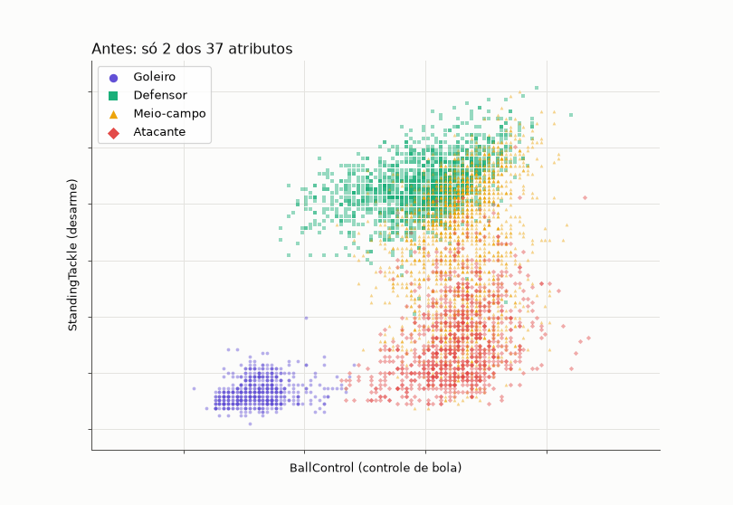

<sub>5.000 jogadores sorteados: de <b>2 atributos escolhidos à mão</b> para os <b>37 atributos resumidos pelo PCA</b>.</sub>

</div>

---

## 🎯 Problema e objetivo

Cada jogador do FIFA 19 é descrito por dezenas de atributos: finalização, desarme, reflexos de goleiro,
altura e outros. Com tantas dimensões, fica difícil comparar jogadores ou perceber **tipos** de jogador
só olhando as tabelas.

> [!TIP]
> **Objetivo:** reduzir os 37 atributos a poucas dimensões com PCA para
> **(1)** revelar padrões em um mapa 2D interpretável e
> **(2)** apoiar um classificador de posição (Goleiro · Defensor · Meio-campo · Atacante),
> medindo quanta informação se perde no caminho.

## 👥 Integrantes

| | Integrante | Frente principal |
|:-:|---|---|
| 📦 | **Kawan Henrique da Silva** | Dados e EDA |
| 🧮 | **Vinícius Silveira Campos** | Pré-processamento e PCA |
| 🧪 | **Daniel da Silva Vecchi Arlindo** | Experimentos |
| 🖥️ | **Vinicius Noboru Hatamoto** | Protótipo web |
| 📣 | **Camile Adalberto Arantes** | Comunicação e materiais |

## 🛠️ Tecnologias

| Camada | Ferramentas |
|---|---|
| Linguagem e ambiente | Python 3.12 · [uv](https://docs.astral.sh/uv/) |
| Dados e modelo | pandas · NumPy · scikit-learn (`StandardScaler`, `PCA`, `LogisticRegression`) |
| Gráficos | matplotlib (figuras e GIFs) · Plotly (gráficos interativos) |
| Protótipo | Streamlit |
| Qualidade | pytest · ruff · black · GitHub Actions |
| Artigo | LaTeX (abnTeX2), compilado pelo CI na `main` |

## 📊 Dataset e fonte

| | |
|---|---|
| **Nome** | FIFA 19 Complete Player Dataset |
| **Fonte** | [Kaggle · javagarm](https://www.kaggle.com/datasets/javagarm/fifa-19-complete-player-dataset) (dados extraídos de [sofifa.com](https://sofifa.com/)) |
| **Licença** | CC BY-NC-SA 4.0: uso não comercial, com atribuição e compartilhamento pela mesma licença |
| **Arquivo** | `data/raw/data.csv`: 18.207 linhas × 88 colunas · Windows-1252 · SHA-256 `ea6f8516…279b` |
| **Amostra final** | **18.147 jogadores**: 60 sem posição foram descartados, com a contagem registrada no log |
| **Atributos (37)** | 34 habilidades 0–100 (`Crossing` … `GKReflexes`) + altura (cm) + peso (kg) + `International Reputation` (1–5) |
| **Alvo** | `Position` (27 códigos) → 4 grupos |

| 🟣 Goleiro | 🟢 Defensor | 🟡 Meio-campo | 🔴 Atacante |
|:-:|:-:|:-:|:-:|
| **2.025** | **5.866** | **6.838** | **3.418** |
| GK | CB · LCB · RCB · LB · RB · LWB · RWB | CDM · LDM · RDM · CM · LCM · RCM · CAM · LAM · RAM · LM · RM | ST · LS · RS · CF · LF · RF · LW · RW |

## 🚀 Instalação e execução

```bash
git clone https://github.com/ViniciusSilveiraCampos/football-pca-map.git
cd football-pca-map
uv sync                              # cria .venv e instala tudo

uv run football-pca-map download     # baixa data/raw/data.csv do Kaggle (sem login)
uv run football-pca-map analyze      # EDA + mapa + experimentos E1–E4 → outputs/
uv run football-pca-map gifs         # animações dos gráficos → docs/img/
uv run task app                      # protótipo em http://localhost:8501
```

<details>
<summary><b>Comandos de desenvolvimento</b></summary>

```bash
uv run task format        # ruff --fix + black
uv run task lint          # o mesmo que o CI
uv run task test          # pytest com cobertura
uv run task screenshots   # capturas do protótipo em docs/img/ (precisa de Chromium)
```

Se o download automático falhar, baixe o zip na página do Kaggle e salve o CSV como `data/raw/data.csv`.

</details>

## 🔁 Reprodução do treinamento e dos experimentos

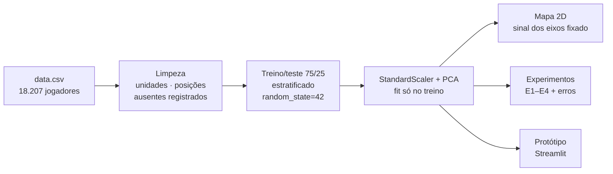

- O `fit` do scaler e do PCA usa **só o treino**. Teste, mapa e jogadores criados no protótipo passam
  apenas por `transform`.
- O sinal dos componentes é fixado (PC1 positivo = `BallControl` alto; PC2 positivo = `StandingTackle`
  alto), então o mapa sai sempre com a mesma orientação.
- Toda etapa aleatória usa `random_state=42`.

| Saída | Conteúdo |
|---|---|
| `outputs/figures/` | mapa, baseline, distribuição das posições, correlações, scree, loadings, matrizes de confusão |
| `outputs/tables/` | uma tabela CSV por experimento, loadings, coordenadas de todos os jogadores, erros por posição |
| `outputs/results.json` | resumo numérico de tudo |
| `docs/img/anim_*.gif` | as animações deste README |

## 📈 Resultados principais

> [!NOTE]
> Resultados preliminares do Checkpoint 1 (20/10/2026). A interpretação final fica para o Checkpoint 2.

### O mapa: 2 componentes guardam 66% da informação

<div align="center">

</div>

| Eixo | Variância | O que mede | Atributos com maior peso |
|---|:-:|---|---|
| **PC1** | **52,1%** | goleiro ←→ jogador de linha habilidoso | `BallControl` · `Dribbling` · `ShortPassing` · `Crossing` · `Positioning` |
| **PC2** | **13,9%** | ataque ←→ defesa | ⬆ `StandingTackle` · `SlidingTackle` · `Interceptions` · `Marking` ⬇ `Finishing` · `Agility` · `Balance` |

Os goleiros formam um bloco isolado. Média nos atributos de goleiro: **63,8** nos goleiros contra
**10,5** nos jogadores de linha.

### A intuição: o PCA procura a direção em que os dados mais se espalham

<div align="center">
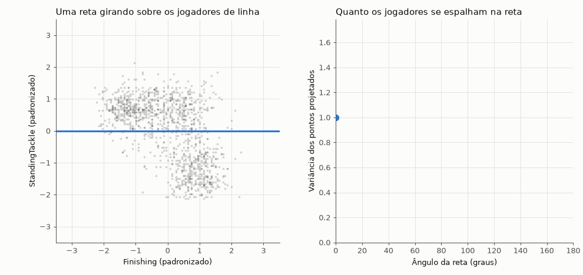
</div>

Com só 2 atributos (finalização e desarme), a reta que gira mostra a ideia: o **PC1** é a direção em que
a projeção dos jogadores tem a **maior variância**. No caso, a diagonal "atacante ←→ defensor". Com 37
atributos, o PCA faz a mesma busca em 37 dimensões.

### E2 · Quanta informação cada componente guarda

<div align="center">
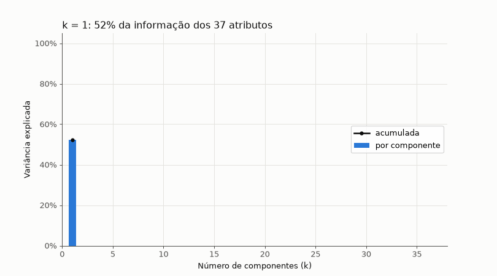
</div>

**80%** da variância com **k = 4** componentes · **90%** com **k = 10**.

### E3 · O classificador de posição com k componentes

<div align="center">
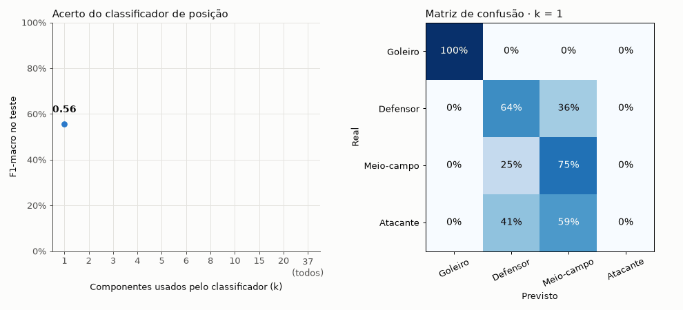
</div>

| Entrada | Dummy | PCA k=2 | k=3 | k=5 | k=10 | 37 atributos |
|---|:-:|:-:|:-:|:-:|:-:|:-:|
| **F1-macro (teste)** | 0,137 | 0,702 | 0,818 | 0,842 | 0,881 | **0,895** |

Com **10 componentes**, o classificador fica a 1,4 ponto do modelo com os 37 atributos.

### Todos os experimentos

| | Experimento | Resultado |
|:-:|---|---|
| 🧪 | **E1** · com × sem padronização | Os loadings mudam: sem padronizar, o PC1 é puxado por `Dribbling`/`Positioning`/`LongShots`, os atributos de maior variância. **Inesperado:** com k=2, o classificador sem padronização teve F1 **maior** (0,784 contra 0,702). A investigar. |
| 📉 | **E2** · variância por k | 80% com k = 4 · 90% com k = 10 |
| 🎯 | **E3** · classificador por k | 0,702 (k=2) → 0,881 (k=10) → 0,895 (37 atributos) |
| 🧤 | **E4** · PCA sem goleiros | PC1 cai para 31,6% (drible, controle de bola, chute de longe) e PC2 sobe para 17,7% (interceptação, desarme). Sem os goleiros, o eixo principal vira "habilidade ofensiva". |

<details>
<summary><b>🔍 Onde o modelo mais erra</b></summary>

<br>

Regressão logística com os 37 atributos, conjunto de teste:

| Posição | Grupo real | Erro | Previsto quando erra |
|---|---|:-:|---|
| RW (ponta-direita) | Atacante | 68% | Meio-campo |
| LW (ponta-esquerda) | Atacante | 61% | Meio-campo |
| RWB (ala-direito) | Defensor | 44% | Meio-campo |
| CDM (volante) | Meio-campo | 17% | Defensor |
| GK (goleiro) | Goleiro | **0%** | — |

A maior parte das confusões está nas **fronteiras de rótulo que nós mesmos definimos**: pontas que jogam
como meias e volantes que marcam como zagueiros.

<div align="center">
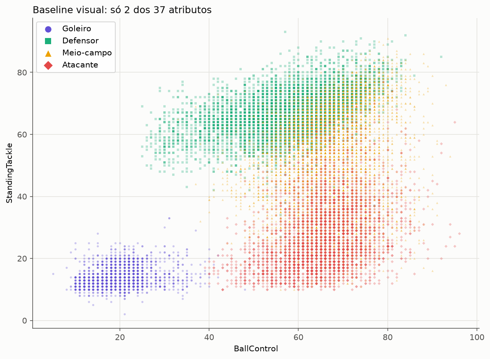
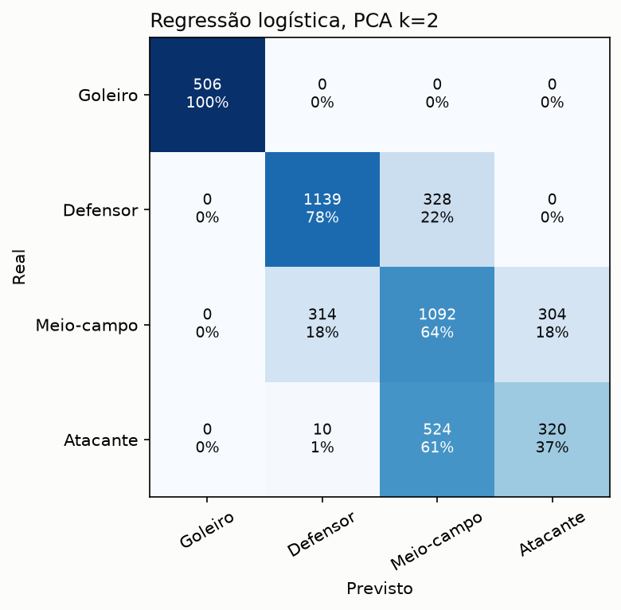
</div>

</details>

## 🖥️ Imagens do protótipo

O protótipo ([`app.py`](src/football_pca_map/app.py)) roda com `uv run task app`. No primeiro acesso, ele
treina o PCA e os classificadores (~25 s); depois, cada interação leva menos de 1 s.

<table>
<tr>
<td width="50%"><b>🗺️ Mapa</b>: busque um jogador e veja os mais parecidos<br><br>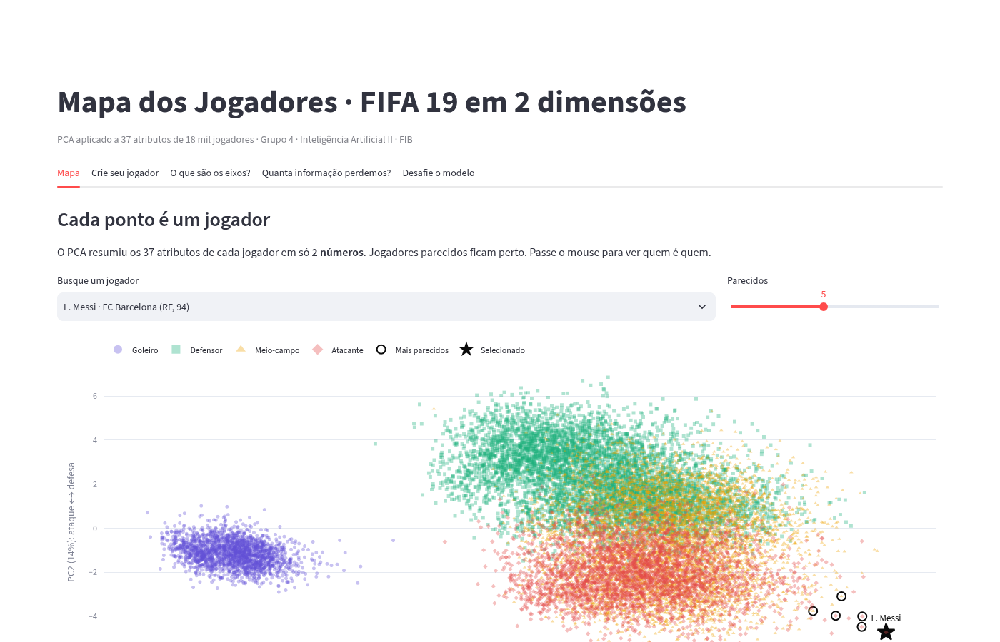</td>
<td width="50%"><b>🧪 Crie seu jogador</b> (Demo Challenge): o Messi com atributos de goleiro vira <i>Goleiro 99%</i> com 37 atributos, mas continua <i>Atacante</i> só com PC1 e PC2<br><br>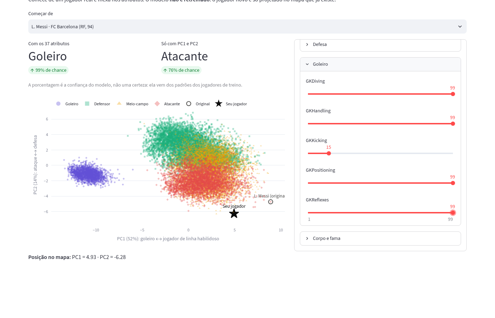</td>
</tr>
<tr>
<td><b>📐 O que são os eixos?</b>: os atributos que formam PC1 e PC2<br><br>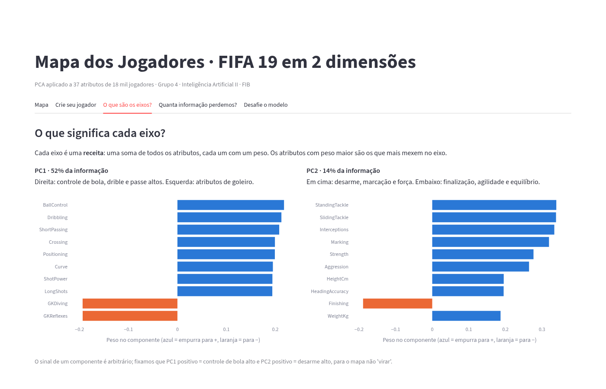</td>
<td><b>🎯 Desafie o modelo</b>: casos reais em que o classificador erra, e por quê<br><br>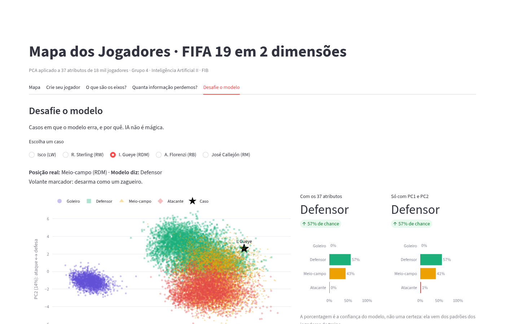</td>
</tr>
</table>

## ⚠️ Limitações conhecidas

> [!WARNING]
> **Não use** este modelo como base única para avaliar, contratar ou escalar jogadores reais.

- 🎮 **Atributos de videogame:** as notas são atribuídas pela EA Sports no FIFA 19 (temporada 2018/19), não
  são medições reais de desempenho. Pode haver viés a favor de ligas e jogadores mais conhecidos.
- 🏷️ **Rótulo de posição simplificado:** 27 posições viram 4 grupos, e as fronteiras Meio/Ataque (LM/RM ×
  LW/RW) e Defensor/Meio (alas, volantes) são uma decisão nossa. Boa parte dos "erros" está aí.
- 🔢 **Escolha dos 37 atributos:** os 3 atributos além das 34 habilidades (altura, peso, reputação) foram
  escolhidos para reproduzir a figura de referência do grupo. Outras combinações dão variâncias parecidas.
- 📏 **PCA é linear:** relações não lineares não são capturadas, e cada componente mistura todos os
  atributos, o que exige ler os loadings para interpretar.
- 🧹 **Qualidade da fonte:** 590 nomes perderam caracteres especiais no CSV original (ex.: `Szcz?sny`), e
  T. Kroos e M. ter Stegen estão sem `Age`/`Overall` (colunas que não usamos no PCA).

## 🔗 Links

| Material | Link |
|---|---|
| 🖥️ Aplicação web | local: `uv run task app` · deploy público _a publicar_ |
| 🎬 Vídeo (1–3 min) | _a publicar_ |
| 📄 Resumo expandido | [`artigo/main.tex`](artigo/main.tex) (PDF gerado pelo CI na `main`) |
| 📰 Folder | _a publicar_ |
| 📱 Carrossel do Instagram | _a publicar_ |
| 🪪 Model Card | _a publicar_ |
| 🗺️ Plano de ação | [`docs/PLANO_DE_ACAO.md`](docs/PLANO_DE_ACAO.md) |

---

<div align="center">

<sub>Faculdades Integradas de Bauru · Ciência da Computação · Inteligência Artificial II · 2026</sub>
<br>
<sub>Detalhes técnicos em <a href="CLAUDE.md"><code>CLAUDE.md</code></a> · regras do revisor de PR em <a href="REVIEW.md"><code>REVIEW.md</code></a></sub>

</div>
