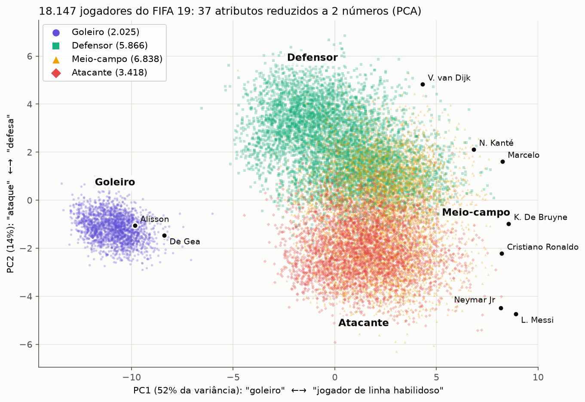

# Plano de Ação — Grupo-base 4 · PCA no FIFA 19

> Baseado nos materiais do professor (`Ronaldo_Seminario/Seminário IA II/01` a `09`) e no Canvas
> inicial do Grupo 4. Atualize a coluna **Status** a cada encontro: ☐ a fazer · ◐ em andamento · ☑ feito.

## 1. Identificação

| Item | Valor |
|---|---|
| Disciplina | Inteligência Artificial II — Faculdades Integradas de Bauru (FIB) |
| Grupo | Grupo-base 4 |
| Tema sorteado | **4 — PCA: "Como enxergar dados com muitas dimensões?"** |
| Orientação do desafio | Reduzir muitas características para visualizar padrões e apoiar outro algoritmo. Desafio com dados: padronização, variância explicada e perda de informação. Comparação mínima: desempenho/visualização antes × depois do PCA. Protótipo: mapa 2D interativo. |
| Apresentação | **17/11/2026**, 19h–22h, posição 4 (último grupo do Dia 1) |
| Entrega final (comum a todos) | **17/11/2026, até 17h** |
| Congelamento técnico | **10/11/2026**: depois disso, só correção, refinamento e comunicação |
| Repositório | `football-pca-map` |

**Integrantes:** Vinicius Noboru Hatamoto · Daniel da Silva Vecchi Arlindo · Camile Adalberto Arantes ·
Vinícius Silveira Campos · Kawan Henrique da Silva

**Objetivo em uma frase:** jogadores têm dezenas de atributos, difíceis de comparar e visualizar. Vamos
reduzi-los a poucas dimensões com PCA para revelar padrões em um mapa 2D e apoiar um classificador de posição.

**Fluxo esperado (doc 01):** Problema → Dados → Investigação → Modelo → Evidências → Produto → Comunicação.

## 2. Responsáveis

Divisão do Canvas do grupo. Cada frente tem um titular e um apoio. **Todos** devem saber explicar
o projeto completo (doc 03 §6), porque qualquer integrante pode ser questionado individualmente.

| Frente | Titular | Apoio | Responde por |
|---|---|---|---|
| Dados / EDA | **Kawan** | Daniel | Download, documentação do dataset, limpeza, mapeamento de posições, descobertas da EDA |
| Pré-processamento e PCA | **Vinícius Silveira** | Kawan | `Pipeline` scaler + PCA, loadings, variância explicada, fixação de sinal, organização do código e CI |
| Experimentos | **Daniel** | Vinícius Silveira | Hipóteses, ficha de experimentos, baseline, classificador, métricas, análise de erros |
| Protótipo web | **Vinicius Noboru** | Vinícius Silveira | App Streamlit, Demo Challenge, deploy, Plano B offline |
| Comunicação e materiais | **Camile** | Vinicius Noboru | Slides, resumo expandido, folder, Instagram, vídeo, Model Card, revisão ortográfica |
| Diário de IA | **Cada integrante** registra o próprio uso · Camile consolida | — | Doc 09 (sem nota, doc 08) |

## 3. Canvas atualizado (substitui o Iris pelo FIFA 19)

| Campo | Conteúdo |
|---|---|
| Tema/técnica | PCA (Análise de Componentes Principais) para reduzir dimensionalidade, visualizar dados e apoiar classificação. |
| Problema a resolver | Um jogador do FIFA 19 é descrito por dezenas de atributos (finalização, desarme, reflexos de goleiro…). Comparar jogadores ou enxergar "tipos" de jogador assim é difícil. O PCA resume esses atributos em 2–3 eixos interpretáveis. |
| Usuário/público | Torcedores, jogadores de FIFA, olheiros e estudantes. Na demo, qualquer pessoa da plateia busca um jogador ou cria um e vê onde ele cai no mapa. |
| Entrada do sistema | Atributos numéricos (0–100) de um jogador existente ou criado com sliders. |
| Saída esperada | Ponto no mapa 2D (PC1 × PC2), jogadores mais parecidos, posição prevista (Goleiro/Defensor/Meio-campo/Atacante), % de variância explicada e o significado de cada eixo (loadings). |
| Dataset/fonte | **FIFA 19 Complete Player Dataset**: <https://www.kaggle.com/datasets/javagarm/fifa-19-complete-player-dataset> (`data.csv`, ~18,2 mil jogadores). Documentar: licença (conferir na página do Kaggle), nº de linhas/colunas, colunas usadas, linhas com atributos ausentes descartadas **com registro** (→ 18.147 jogadores na figura de referência). |
| Variáveis | 37 atributos numéricos de habilidade (lista exata registrada no código e no README). `Position` (27 códigos) agrupada em 4 classes: **Goleiro** (GK); **Defensor** (CB, LCB, RCB, LB, RB, LWB, RWB); **Meio-campo** (CDM, LDM, RDM, CM, LCM, RCM, CAM, LAM, RAM, LM, RM); **Atacante** (ST, LS, RS, CF, LF, RF, LW, RW). |
| Baseline | (a) **Visual:** dispersão de 2 atributos originais escolhidos à mão (ideia do Canvas). (b) **Modelo:** classificador de posição nos 37 atributos sem PCA, mais um `DummyClassifier` (classe mais frequente) como piso. |
| Hipóteses iniciais | **H1:** 2 componentes preservam boa parte da variância (> 60%) e já separam goleiros de jogadores de linha. **H2:** PC2 separa perfis ofensivos de defensivos. **H3:** um classificador com poucos componentes chega perto do classificador com os 37 atributos. **H4:** sem goleiros, a estrutura dos componentes muda. |
| Experimentos planejados | E1–E4 (ver §5). |
| Ideia do protótipo web | "Mapa dos Jogadores" em Streamlit + Plotly (ver §6). |

**Resultado de referência (figura do grupo):** 18.147 jogadores, 37 atributos. PC1 explica 52% da
variância ("goleiro ↔ jogador de linha habilidoso") e PC2 explica 14% ("ataque ↔ defesa"). Goleiros formam
um bloco isolado, defensores ficam no topo e atacantes embaixo, com meio-campistas misturados entre os dois.
Craques (Messi, Neymar, De Bruyne, Van Dijk) ficam na borda direita.

## 4. Cronograma e checkpoints

### 4.1 Já ocorrido

| Data | Etapa | Status |
|---|---|---|
| 06/10 | Kickoff — DEFINIR (Canvas, pitch) | ☑ |
| 13/10 | Marco assíncrono: problema, dataset, referências, divisão de responsabilidades | ☑ (refazer o Canvas com o FIFA 19, §3) |

### 4.2 Até 27/10 — Checkpoint 1: CONSTRUIR

| Tarefa | Responsável | Status |
|---|---|---|
| Baixar `data.csv` para `data/raw/` (fora do git) e escrever as instruções de download no README | Kawan | ☑ |
| Documentar a fonte, a licença, o nº de registros e o dicionário dos 37 atributos | Kawan | ☑ |
| Tratar ausentes (dropna **com contagem registrada**) e mapear as 27 posições em 4 classes | Kawan | ☑ |
| EDA com ≥ 3 descobertas: distribuição das classes (desbalanceamento), matriz de correlação dos atributos, goleiros como bloco separado, distribuição do overall | Kawan + Daniel | ☑ |
| Módulos em `src/football_pca_map/` (carga, features, `Pipeline(StandardScaler, PCA)`) com `random_state` fixo | Vinícius Silveira | ☑ |
| Fixar o sinal dos componentes, para que "PC1 positivo = jogador de linha" seja sempre verdade | Vinícius Silveira | ☑ |
| Testes em `tests/` (mapeamento de posições, shape da saída, `fit` só no treino) | Vinícius Silveira | ☑ |
| Baseline visual (2 atributos) e baseline de modelo (Dummy + classificador nos 37 atributos) | Daniel | ☑ |
| Pipeline ponta a ponta gerando a figura 2D em `outputs/` | Vinícius Silveira | ☑ |
| Esqueleto do app Streamlit carregando o modelo salvo | Vinicius Noboru | ☑ |
| Atualizar o Canvas (docx) com o FIFA 19 | Camile | ☐ |
| Começar o Diário de IA (doc 09) | Todos | ☐ |

### 4.3 Até 03/11 — Checkpoint 2: INVESTIGAR · presença individual vale 0,2

| Tarefa | Responsável | Status |
|---|---|---|
| Registrar a hipótese **antes** de rodar cada experimento (§5) | Daniel | ☐ |
| Rodar E1, E2 e E3 (E4 opcional) com split estratificado treino/teste e `random_state` fixo | Daniel + Vinícius Silveira | ☐ |
| Justificar as métricas (variância explicada, F1-macro, matriz de confusão) | Daniel | ☐ |
| Analisar ≥ 3 erros/casos-limite (§5.2) | Daniel + Kawan | ☐ |
| Interpretar os loadings de PC1 e PC2 (quais atributos pesam mais) | Vinícius Silveira | ☐ |
| Protótipo com mapa interativo e busca de jogador | Vinicius Noboru | ☑ |
| Escrever conclusões provisórias e limitações | Todos | ☐ |

### 4.4 Até 10/11 — Pré-banca: VALIDAR · congelamento técnico · presença 0,2

| Tarefa | Responsável | Status |
|---|---|---|
| Protótipo completo: "crie seu jogador", escolha de k, posição prevista | Vinicius Noboru | ☑ |
| Demo de 10 min (problema, dataset, técnica, principal experimento, protótipo) + 5 min de perguntas | Todos (Camile organiza) | ☐ |
| Checklist da pré-banca (§10.1) completo | Todos | ☐ |
| **Código, modelo e protótipo congelados** | Vinícius Silveira | ☐ |

### 4.5 De 10/11 a 17/11 — Refinar e comunicar

| Tarefa | Responsável | Status |
|---|---|---|
| Aplicar o feedback da pré-banca (só correções) | Responsável de cada frente | ☐ |
| Model Card (§7.1) | Camile + Daniel | ☐ |
| Resumo expandido de 2 páginas no template da Jornada Científica da FIB (`artigo/main.tex`) | Camile + Vinícius Silveira | ☐ |
| Folder com dobra e QR Code | Camile | ☐ |
| Carrossel do Instagram | Camile + Vinicius Noboru | ☐ |
| Vídeo de 1–3 min | Vinicius Noboru + Camile | ☐ |
| Slides da palestra | Camile (cada um escreve o próprio bloco) | ☐ |
| README final (§7.2) com GIF do protótipo | Vinícius Silveira | ☐ |
| Pelo menos 2 ensaios cronometrados de ~40 min | Todos | ☐ |
| Checklist da entrega final (§10.2) | Todos | ☐ |

### 4.6 Datas finais

| Data | O quê |
|---|---|
| **17/11, até 17h** | Entrega do pacote completo |
| **17/11, à noite** | **Nossa apresentação** (posição 4) · presença 0,2 |
| 24/11 | Apresentações dos temas 5–8 · presença 0,2 (obrigatória mesmo sem apresentar) |
| 01/12 | Apresentações dos temas 9–10 · presença 0,2 |

## 5. Ficha de experimentos planejada

Regras: hipótese escrita **antes** de rodar. Mesmo split treino/teste estratificado e mesmo `random_state`
em todos os experimentos. `fit` do scaler e do PCA **só no treino** (o resto usa `transform`). Resultado
negativo bem investigado também vale (doc 01 §7).

| Exp. | Hipótese | Alteração | Métrica/resultado | Interpretação |
|---|---|---|---|---|
| E1 | Os atributos já estão na escala 0–100, então padronizar muda pouco o PCA. Se entrarem altura, peso e idade (escalas diferentes), a padronização passa a ser essencial. | PCA com × sem `StandardScaler`; repetir incluindo altura/peso/idade. | Variância explicada por PC; loadings de PC1; F1-macro do classificador. | _preencher_ |
| E2 | Poucos componentes concentram a maior parte da variância. | k = 1…37, curva de variância acumulada (scree). | k necessário para 80% e 90%; variância de PC1+PC2. | _preencher_ |
| E3 | Um classificador com poucos componentes chega perto do classificador com os 37 atributos. | Regressão logística (e/ou KNN) com 37 atributos × k = 2, 3, 5, 10 componentes. | F1-macro, matriz de confusão, tempo de treino. Comparar com o Dummy. | _preencher_ |
| E4 (opcional) | Sem goleiros, PC1 deixa de ser "goleiro × linha" e passa a separar outro perfil (ofensivo × defensivo?). | Refazer o PCA só com jogadores de linha. | Variância explicada e loadings novos; mapa 2D. | _preencher_ |

**Por que essas métricas:** a variância explicada mede quanta informação o mapa preserva. A acurácia sozinha
engana porque as classes são desbalanceadas (há bem menos goleiros que meio-campistas), então usamos o
F1-macro. A matriz de confusão mostra *quais* posições o modelo confunde.

### 5.2 Erros e casos-limite a investigar (mínimo 3)

| # | Caso | Hipótese para o erro |
|---|---|---|
| 1 | Laterais/alas (LB, RB, LWB, RWB) previstos como Meio-campo | Atributos de cruzamento e velocidade parecidos com os de meias de lado |
| 2 | Volantes (CDM) previstos como Defensor | Desarme e marcação altos, parecidos com os de zagueiros |
| 3 | Meias de lado (LM, RM) × pontas (LW, RW) | A fronteira Meio/Ataque é uma decisão de rótulo nossa, não um fato dos dados |
| 4 | Jovens de overall baixo amontoados no centro do mapa | Atributos baixos em tudo deixam o perfil pouco definido |
| 5 | Inversão de sinal dos componentes entre execuções | O sinal do autovetor é arbitrário. Sem fixá-lo, o "lado" do mapa muda |

## 6. Protótipo web (Streamlit + Plotly)

| Recurso | Para quê |
|---|---|
| Mapa 2D interativo com os 18 mil jogadores coloridos por posição, hover com nome e clube | Mostrar o padrão principal |
| Busca de jogador, destacando os N vizinhos mais próximos | "Quem joga parecido com o Messi?" |
| **"Crie seu jogador"**: sliders de atributos, projetados com `transform` (sem refit) | **Demo Challenge**: o professor ou a plateia inventa um jogador na hora |
| Painel "O que significa cada eixo?" com os loadings em linguagem simples | Teste do adolescente |
| Seletor de k e gráfico de variância explicada | Mostrar quanta informação o mapa perde |
| Posição prevista com 37 atributos × com k componentes | Ligação com o E3 |
| Botão "Desafie o modelo" com casos ambíguos prontos (§5.2) | Mostrar limitações |

**Plano B:** vídeo local da demo, screenshots e um app que roda offline em `localhost` com os dados já processados.

## 7. Matriz de entregas (pacote final: 17/11, 17h)

| Entrega | Formato | Responsável | Apoio | Status |
|---|---|---|---|---|
| Palestra | 40 min de conteúdo + perguntas | Todos | Camile organiza | ☐ |
| Protótipo web | Streamlit funcional | Vinicius Noboru | Vinícius Silveira | ☐ |
| Repositório | GitHub: código, README, execução, experimentos, resultados | Vinícius Silveira | Todos | ☐ |
| Resumo expandido | 2 páginas, template da Jornada FIB | Camile | Vinícius Silveira | ☐ |
| Folder | 1 página com dobra + QR Code | Camile | Vinicius Noboru | ☐ |
| Instagram | Carrossel de 6–7 cards | Camile | Vinicius Noboru | ☐ |
| Vídeo | 1–3 min | Vinicius Noboru | Camile | ☐ |
| Model Card | 1 página | Camile | Daniel | ☐ |
| Ficha de experimentos | Tabela (§5) | Daniel | Vinícius Silveira | ☐ |
| Diário de IA | Modelo do doc 09 (sem nota) | Cada integrante | Camile consolida | ☐ |

### 7.1 Model Card: o que preencher

Nome da solução · Problema · Técnica (PCA + classificador) · Dados (FIFA 19, nº final de jogadores) ·
37 atributos · Pré-processamento (dropna registrado, padronização, split estratificado) · Métrica principal
(variância explicada + F1-macro) · Resultado principal · Baseline · Limitações (atributos do *jogo* FIFA,
não medições reais; temporada 2019; rótulo de posição simplificado) · Vieses/riscos (notas atribuídas pela
EA, com possível viés para ligas e jogadores famosos) · **Quando não usar:** como única base para
contratar ou avaliar jogadores reais.

### 7.2 README final (mínimo do doc 04)

Problema e objetivo · integrantes · tecnologias · dataset e fonte · instalação (`uv sync`) e execução ·
reprodução dos experimentos (seeds) · resultados principais · GIF do protótipo · limitações · links (app,
vídeo, resumo, folder, carrossel).

### 7.3 Conteúdo de divulgação

- **Folder:** capa "Messi e Van Dijk cabem no mesmo mapa?", o problema, a analogia (sombra 2D de um objeto
  3D, escolhida para mostrar o máximo de detalhes), o resultado principal, um print do mapa, o QR Code do
  app e os créditos.
- **Instagram:** (1) "Dá pra resumir um jogador em 2 números?" (2) o problema (3) os dados: 18 mil jogadores
  (4) a analogia da sombra (5) o experimento: 37 atributos × 2 componentes (6) "nem sempre acerta": volante
  × zagueiro (7) "teste você mesmo" + QR Code.
- **Vídeo:** 0–10 s pergunta · 10–30 s ideia do PCA · 30–100 s demo (buscar o Messi, criar um jogador) ·
  100–140 s resultado e limitação · final com QR Code.

## 8. Roteiro da palestra (~40 min)

| Bloco | Tempo | Dono | Conteúdo |
|---|---|---|---|
| Abertura | 3–5 min | Camile | "Como comparar 18 mil jogadores com 37 notas cada?" |
| Problema | 4–6 min | Camile | Contexto, público, por que vale resolver |
| Conceitos e algoritmo | 8–12 min | Vinícius Silveira | Analogia da sombra → variância, autovetores, loadings |
| Dados | 5–8 min | Kawan | Origem, variáveis, limpeza, mapeamento de posições, descobertas da EDA |
| Experimentos | 8–12 min | Daniel | Baseline, E1–E4, métricas, resultados |
| Erros e limitações | 4–6 min | Daniel + Kawan | Casos do §5.2, riscos, quando não usar |
| Protótipo ao vivo | 6–10 min | Vinicius Noboru | Demo + Demo Challenge com a plateia |
| Conclusões | 2–4 min | Vinícius Silveira | O que aprendemos e quando o PCA faz ou não sentido |
| Perguntas | variável | Todos | — |

### 8.1 Autoavaliação pelos critérios (100 pts)

| Critério | Pts | Pronto? |
|---|---|---|
| Problema e contexto | 10 | ☐ |
| Dados e preparação | 15 | ☐ |
| Domínio conceitual | 15 | ☐ |
| Experimentos e comparação | 20 | ☐ |
| Análise crítica | 15 | ☐ |
| Protótipo e demonstração | 15 | ☐ |
| Comunicação e palestra | 10 | ☐ |

**Teste do adolescente:** alguém de 14–16 anos entende qual era o problema, quais dados entraram, o que a IA
fez, o que saiu e por que é útil?

## 9. Banco de perguntas (todos precisam saber responder)

**Obrigatórias (doc 03):**
1. Por que o PCA foi escolhido?
2. Qual seria uma alternativa mais simples? (escolher 2 atributos à mão)
3. Qual foi o maior problema encontrado nos dados?
4. O que aconteceria se um atributo importante fosse removido?
5. Como vocês evitaram avaliar só no conjunto de treino?
6. Qual métrica foi priorizada e por quê?
7. Onde o modelo mais errou?
8. Que mudança poderia melhorar o projeto?
9. Como o protótipo transforma o modelo em uma aplicação compreensível?

**Específicas de PCA:**
10. O que são autovetores e autovalores aqui? O que significa "PC1 explica 52%"?
11. Por que padronizar antes do PCA? O que muda se não padronizar?
12. Por que o sinal de um componente é arbitrário e como vocês lidaram com isso?
13. Quanta informação se perde ao ficar com só 2 componentes?
14. O PCA é supervisionado? Ele "sabe" a posição dos jogadores?
15. PCA não é clusterização: por que os grupos aparecem mesmo assim?
16. Por que não usar t-SNE ou UMAP? (o PCA é linear, interpretável e projeta jogadores novos com `transform`)
17. Como um jogador novo, criado na demo, é colocado no mapa sem refazer o PCA?

## 10. Checklists

### 10.1 Pré-banca (10/11)

- [ ] Dataset e preparação concluídos (fonte documentada, dropna registrado, classes inspecionadas)
- [ ] Baseline e PCA + classificador funcionando
- [ ] Três experimentos documentados na ficha
- [ ] Análise de pelo menos três erros
- [ ] Protótipo funcional
- [ ] Conclusões sustentadas por resultados

### 10.2 Entrega final (17/11, 17h)

- [ ] Protótipo testado em outro computador/navegador
- [ ] Plano B para falha de internet
- [ ] Slides revisados e legíveis
- [ ] Núcleo da palestra ensaiado em ~40 min
- [ ] Todos sabem explicar o projeto completo
- [ ] Resultados e métricas conferidos com o código final
- [ ] QR Codes testados
- [ ] GitHub organizado (README, estrutura, CI verde)
- [ ] Resumo expandido, folder, Instagram, vídeo, Model Card e ficha de experimentos finalizados
- [ ] Revisão ortográfica
- [ ] Diário de IA entregue

## 11. Riscos e mitigação

| Risco | Mitigação | Dono |
|---|---|---|
| Vazamento de dados (`fit` do scaler/PCA com dados de teste) | `Pipeline` com `fit` só no treino + teste automatizado (regra do `CLAUDE.md`/`REVIEW.md`) | Vinícius Silveira |
| Linhas descartadas sem registro | Logar a contagem antes/depois do `dropna` e citar no README | Kawan |
| Resultados não reprodutíveis | `random_state` fixo em split, PCA e classificador | Daniel |
| Interpretação dos eixos muda entre execuções | Fixar o sinal dos componentes | Vinícius Silveira |
| Dataset do Kaggle exige login | Instruções de download no README; `data/raw/` fora do git | Kawan |
| Internet falha na demo | App local + vídeo + screenshots | Vinicius Noboru |
| Grupo concentrado em uma pessoa | Apoio por frente + ensaio com perguntas sorteadas entre todos | Camile |
| Atrasar o congelamento de 10/11 | Revisar este plano em todo encontro; priorizar E1–E3 antes do E4 | Todos |
